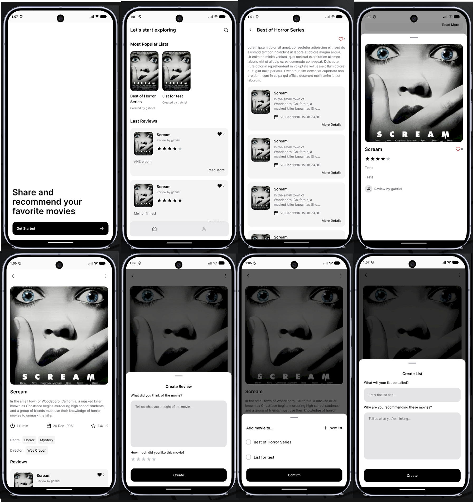

<h1 align="center">Moovie</h1>

<p align="center">Compartilhe resenhas de filmes, monte listas de recomendações e descubra o que a comunidade está assistindo.</p>

<br />

<p align="center">
  
</p>

# Sobre

O Moovie é um aplicativo mobile para compartilhar resenhas de filmes e montar listas de recomendações. Você registra nota e opinião sobre o que assistiu, organiza títulos em listas temáticas e acompanha o que outros usuários publicam.

Na página inicial aparecem listas populares e as resenhas mais recentes; dá para abrir cada item, curtir resenhas e ler o texto completo em um painel. A busca consulta filmes por título (integração com a OMDb) e guarda um histórico local das últimas pesquisas para repetir com um toque. Na ficha do filme você vê destaques da obra e pode criar resenha com nota e texto, ou incluir o título em uma lista de recomendações, criando lista nova ou escolhendo uma existente.

Há cadastro com e-mail e senha, login, recuperação de senha, verificação de e-mail e opção de entrar como convidado (conta anônima). O perfil mostra quantas resenhas e listas você publicou. Resenhas, listas, curtidas e perfil ficam sincronizados na nuvem, ligados à conta. A arquitetura separa repositórios, serviços e adaptadores (HTTP, armazenamento local, feedback), com TanStack Query no cliente e formulários validados com Zod.

# Ferramentas

- [Expo](https://expo.dev/) e [React Native](https://reactnative.dev/)
- [Expo Router](https://docs.expo.dev/router/introduction/)
- [TypeScript](https://www.typescriptlang.org/)
- [Firebase](https://firebase.google.com/docs) (Auth e Firestore)
- [TanStack Query](https://tanstack.com/query)
- [Zustand](https://zustand-demo.pmnd.rs/)
- [React Hook Form](https://react-hook-form.com/) e [Zod](https://zod.dev/)
- [NativeWind](https://www.nativewind.dev/) (Tailwind no React Native)
- [Axios](https://axios-http.com/) e [OMDb API](http://www.omdbapi.com/)

# Rodando o projeto

Você precisa do [Node.js](https://nodejs.org/), [Git](https://git-scm.com/), [npm](https://docs.npmjs.com/) e, no celular, [Expo Go](https://expo.dev/client) ou um emulador. O projeto inclui `expo-dev-client`; para build nativo, use os scripts `android` e `ios`.

1. Clone o repositório:

```bash
git clone https://github.com/gabriellima2/moovie.git
cd moovie
```

2. Instale as dependências:

```bash
npm install
```

3. Configure variáveis de ambiente (veja `.env.example`):

```bash
cp .env.example .env
```

Preencha cada chave no `.env`. Os nomes estão descritos no arquivo de exemplo; você obtém os valores nos painéis do seu backend em nuvem e na API de filmes (OMDb).

| Variável | Uso |
|----------|-----|
| `EXPO_PUBLIC_API_KEY` | Chave pública do projeto de backend |
| `EXPO_PUBLIC_AUTH_DOMAIN` | Domínio de autenticação |
| `EXPO_PUBLIC_PROJECT_ID` | ID do projeto |
| `EXPO_PUBLIC_STORAGE_BUCKET` | Bucket de armazenamento |
| `EXPO_PUBLIC_MESSAGING_SENDER_ID` | ID do remetente (mensageria) |
| `EXPO_PUBLIC_APP_ID` | ID do aplicativo no projeto |
| `EXPO_PUBLIC_MOVIE_API_KEY` | Chave da OMDb para busca e detalhes de filmes |

**Prefixo `EXPO_PUBLIC_`:** no Expo, variáveis com esse prefixo entram no bundle do cliente e ficam visíveis no app, o que facilita o desenvolvimento sem proxy nem build extra. Em um cenário de produção sério, o ideal é refatorar: manter no cliente só o que é realmente público e mover chaves sensíveis (por exemplo, APIs que não devem ser expostas) para uma camada intermediária (BFF, Cloud Functions ou outro backend) que as leia em variáveis privadas no servidor.

4. Inicie o Expo:

```bash
npm run start
```

Escaneie o QR Code no terminal com o Expo Go ou pressione `a` / `i` para o emulador Android ou iOS.

**Scripts adicionais:**

```bash
npm run android   # build e execução nativa Android (dev client)
npm run ios       # build e execução nativa iOS (dev client)
npm run web       # versão web via Metro
npm run test      # testes (Jest + jest-expo)
```

## Encerrar o desenvolvimento

Pare o bundler do Expo (`npm run start`, `npm run android`, etc.) com `Ctrl+C` no terminal onde o Metro está rodando.

<h4 align="center">Projeto feito com 💙 por Gabriel Lima</h4>